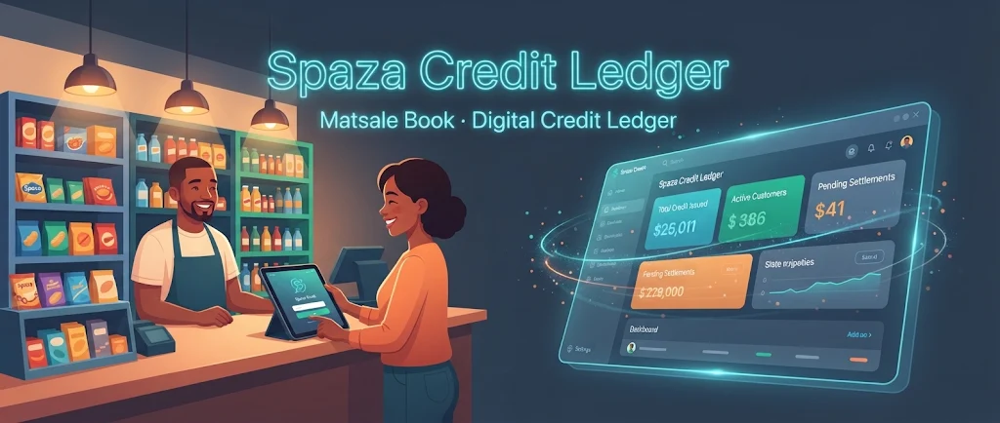

[](https://nextjs.org/)
[](https://tailwindcss.com/)
[](https://supabase.com/)
[](https://github.com/)

# Spaza Credit Ledger

Digital “boek” tracker for informal spaza-shop credit.

Built for the **Samsung Innovation Internship 2027 – Route A**[cite: 7].

## Problem
Township spaza shops still track customer credit in paper notebooks.  
The notebook gets lost, is hard to audit, and the customer has no visibility of their balance.

## Solution
A simple web app with three roles:

| Role     | Can do                                      |
|----------|---------------------------------------------|
| Owner    | Full access, view all balances & history    |
| Cashier  | Record credit sales and payments            |
| Customer | View own balance and transaction history    |

## Tech Stack
- Next.js 15 (App Router)
- Tailwind CSS
- Supabase (Auth + PostgreSQL + Row Level Security)

## Demo Accounts (synthetic data only)
| Email                        | Password  | Role     |
|------------------------------|-----------|----------|
| owner@spaza-ledger.demo      | demo1234  | owner    |
| staff@spaza-ledger.demo      | demo1234  | cashier  |
| customer@spaza-ledger.demo   | demo1234  | customer  |

## Key Design Decisions (whiteboard talking points)

1. **Immutable ledger**  
   We never edit past entries. Every sale or payment is a new row.  
   This mirrors real bookkeeping and makes audits trivial.

2. **Denormalised balance + trigger**  
   `customers.balance` is kept in sync by a database trigger.  
   Fast UI reads, single source of truth remains the ledger.

3. **Defence in depth**  
   - Middleware protects routes by role  
   - Row Level Security protects data even if the UI is bypassed

4. **Zero real personal data**  
   All seed data is synthetic.

---

## Local Setup
```bash
npm install
cp .env.example .env.local   # fill in your Supabase keys
# Run the SQL in database/schema.sql in the Supabase SQL editor
# Ensure the three demo users exist in Supabase Auth, then run database/seed.sql
npm run dev

```
### 1. Install dependencies:

```Bash
npm install

```

### 2. Configure environment variables:
Copy `.env.example` to `.env.local` and add your Supabase project credentials:

```Bash
cp .env.example .env.local
Code snippet
NEXT_PUBLIC_SUPABASE_URL=[https://your-project-ref.supabase.co](https://your-project-ref.supabase.co)
NEXT_PUBLIC_SUPABASE_ANON_KEY=your-anon-key-here
Run the development server:

```
### 3. Run the development server:
```Bash
npm run dev
```
Open http://localhost:3000/login in your browser.

## 📁 Project Structure
```bash
spaza-credit-ledger/
├── app/
│   ├── dashboard/page.tsx   # Authenticated ledger summary dashboard
│   ├── login/page.tsx       # Role-based sign-in screen
│   ├── globals.css          # Tailwind v4 global styles
│   └── layout.tsx           # Root HTML layout & metadata
├── lib/
│   └── supabase/client.ts   # Browser Supabase SSR client
├── public/
│   └── banner.webp          # Repository header banner
├── middleware.ts            # Session refresh & protected route guard
├── .env.example             # Environment variable template
└── package.json
```
---

## 👤 Author
Leonard Phokane

GitHub: [@leonardphokane](https://github.com/leonardphokane)

LinkedIn: [linkedin.com/in/leonard-phokane](https://linkedin.com/in/leonard-phokane)

Portfolio: [ai-software-engineer-portfolio-lac.vercel.app](https://ai-software-engineer-portfolio-lac.vercel.app/)

© 2026 Leonard Phokane · Spaza Credit Ledger (Matsale Book) · Samsung Innovation Internship 2027